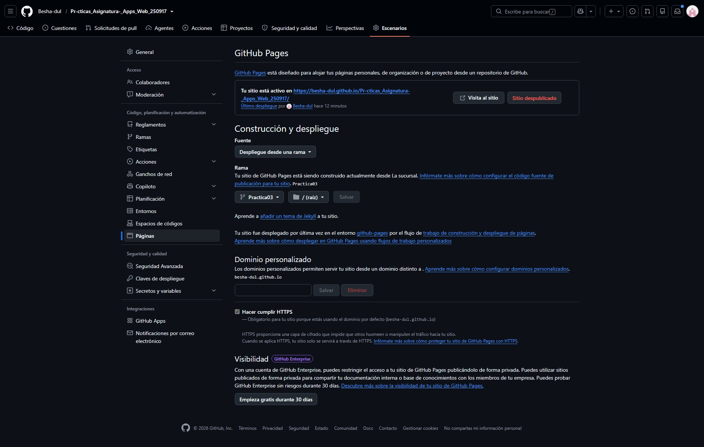
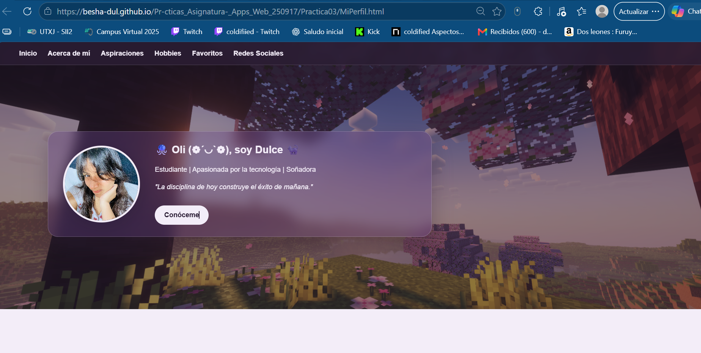

# Prácticas de la Asignatura de Aplicaciones Web
## T.S.U en Desarrollo de Software Multiplataforma
### Docente M.T.I Marco A. Ramírez Hernéndez 
### Alunma: Dulce Marbella Tolentino García 4 cuatrimestre "C" - DSM 
 hi a todo :D 
 
Periodo: Septiembre - Diciembre 2026 

---

### Tabla de Prácticas de la Materia 

| No. | Nombre | Descripcion | Potenciador | Estatus | 
|---|---|---|---|---|
| 1.| Metodología de Evaluación de la Materia | Transcribir en libreta y comprender la metodología y fechas de evaluación | 5 | 🟢 Concluidada| # Practicas de la Asignatura - Apps Web 
| 2. | Mi Primer Página Web | Codificar la primer pagina web con HTML puro, sin estilos ni funcionalidades | 10| 🟢 Concluida |
| 3. | Mi Perfil Personal | Diseñar una página web personal con HTML, CSS y JavaScript, incorporando información personal, aspiraciones, hobbies, favoritos y redes sociales, y publicarla mediante GitHub Pages. | 10 | 🟢 Concluida |

---

# 🚀 Bonus: Hospedaje de la Página Web de Portafolio a través de GitHub Pages (10 firmas)

### 🌐 URL pública del portafolio
[**Visitar mi portafolio personal**](https://besha-dul.github.io/Pr-cticas_Asignatura-_Apps_Web_250917/Practica03/MiPerfil.html)

### 📂 URL del repositorio
[**Ver repositorio en GitHub**](https://github.com/Besha-dul/Pr-cticas_Asignatura-_Apps_Web_250917)

## 1. Procedimiento realizado

1. **Preparación del proyecto:** se subieron los archivos HTML, CSS, JavaScript y recursos multimedia al repositorio de GitHub.
2. **Configuración de GitHub Pages:** se accedió a `Settings → Pages` y se seleccionó la opción `Deploy from a branch`.
3. **Selección de la rama:** se configuró la rama `Practica03` y la carpeta `/ (root)` como fuente de publicación.
4. **Publicación:** se guardó la configuración y se esperó a que GitHub Pages desplegara el sitio.
5. **Verificación:** se abrió la URL pública y se comprobó que el portafolio personal funcionara desde el navegador.

## 2. Dificultades encontradas

- **Visibilidad del repositorio:** inicialmente, GitHub Pages no estaba disponible con la configuración del repositorio privado.
- **Ubicación del archivo HTML:** el archivo `MiPerfil.html` se encontraba dentro de la carpeta `Practica03`, por lo que fue necesario utilizar su ruta específica para abrirlo.
- **Tamaño del video:** GitHub mostró una advertencia porque el archivo de video superaba los 50 MB recomendados.

## 3. Soluciones implementadas

- Se cambió la visibilidad del repositorio a público para habilitar GitHub Pages.
- Se configuró la publicación desde la rama `Practica03` y se utilizó la URL correspondiente a `MiPerfil.html`.
- Se comprobó que el video se subiera correctamente, a pesar de la advertencia de tamaño.

## 4. Evidencias de configuración y publicación

### Captura de la configuración de GitHub Pages

### Captura del portafolio publicado

=======

## Bonus: Hospedaje del portafolio con GitHub Pages

### Objetivo
Publicar mi página web personal utilizando GitHub Pages para que pueda consultarse públicamente mediante una URL.

### Procedimiento realizado
1. Subí los archivos de mi página al repositorio de GitHub.
2. Accedí a Settings → Pages.
3. Seleccioné el despliegue desde una rama.
4. Configuré la rama `Practica03` y la carpeta `/ (root)`.
5. Guardé la configuración y esperé a que GitHub Pages publicara el sitio.
6. Comprobé que mi página se abriera correctamente en el navegador.

### URL pública del portafolio
https://besha-dul.github.io/Pr-cticas_Asignatura-_Apps_Web_250917/Practica03/MiPerfil.html

### URL del repositorio
https://github.com/Besha-dul/Pr-cticas_Asignatura-_Apps_Web_250917

### Dificultades encontradas y soluciones
- **Activación de GitHub Pages:** el repositorio era privado y fue necesario cambiar su visibilidad a público.
- **Ubicación del archivo HTML:** mi archivo `MiPerfil.html` estaba dentro de la carpeta `Practica03`, por lo que utilicé la ruta correspondiente para abrirlo.
- **Tamaño del video:** GitHub mostró una advertencia porque el video superaba los 50 MB recomendados, aunque permitió subirlo.

### Evidencias
- Captura de la configuración de GitHub Pages.
- Captura del portafolio publicado en el navegador.
>>>>>>> Practica03
